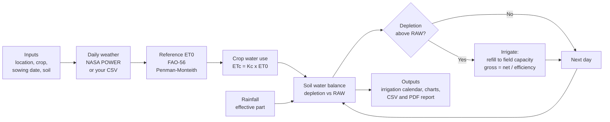

# Crop Water Requirement & Irrigation Scheduling Tool

A Python / Streamlit tool that answers two questions every irrigation manager asks:
**how much water does my crop need, and when should I irrigate?**

It implements the **FAO-56 Penman-Monteith** method end to end: it downloads daily weather
from **NASA POWER**, computes reference evapotranspiration (ET0), converts it to crop water
use (ETc = Kc × ET0), runs a daily root-zone **soil water balance**, and outputs an irrigation
calendar (dates and depths), charts, CSV files and a PDF report.

> **Live demo:** _add your Streamlit Community Cloud link here after deploying_

## How it works



1. **Inputs:** you choose a location, crop, sowing date, soil and irrigation method.
2. **Weather:** daily data come from NASA POWER (or a CSV). Days after the latest observation use a typical year (the median of the last 10 years).
3. **ET0:** reference evapotranspiration is computed with the FAO-56 Penman-Monteith equations.
4. **ETc:** ET0 is multiplied by the crop coefficient (Kc) for each growth stage.
5. **Water balance:** each day the root zone loses ETc and gains effective rain. When depletion passes the readily available water (RAW), an irrigation is scheduled.
6. **Outputs:** dates and depths, soil water charts, a comparison with past years, and downloads.

## Why it matters

Irrigation in many canal-irrigated regions follows fixed turns or habit, which leads to
over-irrigation (wasted water, waterlogging, salinity) or under-irrigation (yield loss).
FAO-56 is the accepted international standard for doing this scientifically, but doing it by hand
in Excel is slow and error-prone. This tool automates it for any location on Earth.

## What you get

| Output | Description |
|---|---|
| Daily ET0 | FAO-56 Penman-Monteith, computed from the equations (no black-box library) |
| Crop water requirement | ETc per day and per growth stage, 10 crops, editable Kc / stage lengths / roots |
| Irrigation calendar | Dates, net and gross depth (mm), volume (m³/ha and m³/acre) |
| Soil water balance | Depletion vs. readily available water, stress days, deep percolation |
| Rainfed comparison | How stressed the crop would be with no irrigation |
| Other years | Same sowing date run through each of the last 10 years (wet vs. dry range) |
| Climate scenario | Add +0 to +5 °C and ±50 % rainfall to see how demand changes |
| Downloads | Schedule CSV, daily balance CSV, PDF report |

## Quick start

```bash
git clone <your-repo-url>
cd crop-water-scheduler
python -m venv .venv && source .venv/bin/activate      # Windows: .venv\Scripts\activate
pip install -r requirements.txt
streamlit run app.py
```

No internet? Choose **Demo data (synthetic, offline)** in the sidebar, or run
`python examples/demo_offline.py`. Demo data is synthetic and for testing only.

### Use it as a library

```python
from datetime import date
from cwr import CROPS, SOILS, compute_daily, climatology, season_frame, run_schedule
from cwr.weather import fetch_nasa_power, clean_weather

raw, elevation = fetch_nasa_power(30.30, 71.93, date(2016, 1, 1), date.today())   # Khanewal
daily = compute_daily(clean_weather(raw), lat=30.30, elevation_m=elevation)
clim = climatology(daily)

crop, soil, sowing = CROPS["Wheat"], SOILS["Loam"], date(2026, 11, 15)
season = season_frame(daily, clim, sowing, crop.season_days)     # observed + typical-year fill
result = run_schedule(season, crop, soil, sowing, application_efficiency=0.6)
print(result.events)       # irrigation calendar
print(result.summary)      # totals
```

## Method

1. **Weather**: NASA POWER daily point data (T2M_MAX, T2M_MIN, RH2M, WS2M, ALLSKY_SFC_SW_DWN,
   PRECTOTCORR). Short gaps are interpolated; a Hargreaves radiation estimate is used if
   radiation is missing.
2. **ET0**: FAO-56 Eq. 6 with vapour pressure (Eq. 11-13, 19), extraterrestrial radiation
   (Eq. 21-25), net radiation (Eq. 37-40), and psychrometric constant (Eq. 7-8).
3. **ETc**: ETc = Kc × ET0 with a four-stage piecewise-linear Kc curve (FAO-56 Fig. 25).
4. **Water balance** (FAO-56 Ch. 8): `Dr,i = Dr,i-1 − Peff − I + ETa + DP`, where
   `TAW = 1000 (θFC − θWP) Zr`, `RAW = p·TAW`, `Ks = (TAW − Dr)/((1−p)·TAW)` once `Dr > RAW`,
   and `p` is adjusted for evaporative demand (`p = p_table + 0.04 (5 − ETc)`, limited to 0.1-0.8).
5. **Irrigation rule**: irrigate on the day depletion would exceed RAW; refill to field capacity
   (or apply a fixed net depth). Gross = net ÷ application efficiency.
6. **Dates beyond available data** use a typical year: the median across the last 10 years of ET0
   and rainfall for each calendar day (each year smoothed first), flagged in the output. The median
   is used because mean rainfall in dry climates is dominated by rare extreme years (and by occasional
   bad values in gridded rainfall), which would make the forecast too optimistic.
   The *Other years* tab warns when a year's season rainfall is more than 3x the median.

## Validation

Run `pytest` (39 tests). Results on the reference examples from FAO-56 (Allen et al., 1998):

| Check | This code | FAO-56 published |
|---|---|---|
| Example 18, Uccle (Belgium) 6 July, ET0 | **3.88 mm/day** | 3.9 mm/day |
| Example 8, Ra at 20° S, 3 Sept | 32.19 MJ m⁻² d⁻¹ | 32.2 |
| Example 9, daylight hours | 11.67 h | 11.7 |
| Example 2, pressure at 1800 m | 81.8 kPa | 81.8 |
| Example 3, e°(24.5 °C) | 3.075 kPa | 3.075 |
| Example 14, wind 3.2 m/s at 10 m → 2 m | 2.4 m/s | 2.4 |

Other automated checks: the soil water balance closes exactly (ΔDr = ETa − Peff − I + DP);
irrigated runs have zero stress; rainfed runs show stress; sandy soils need more frequent
irrigation than clay; heavy storms drain below the root zone; warming raises ET0.
`validation/compare_pyet.py` compares the Penman-Monteith core with the independent
[`pyet`](https://github.com/pyet-org/pyet) library (agreement to 4 decimals on synthetic data;
it uses this project's net-radiation values, so net radiation itself is validated by the FAO
examples above).

**Suggested next validation for your own location:** compare the seasonal ETc and irrigation
dates against FAO CROPWAT 8.0 for the same crop/soil/weather, and (if available) against
soil-moisture sensor or lysimeter data. Report the difference in your write-up.

## Limitations (please read)

* **Single-Kc method**: soil evaporation and transpiration are not separated; Kc_mid / Kc_end
  are not adjusted for local humidity and wind (FAO-56 Eq. 62).
* **Typical parameters**: crop stage lengths, Kc, root depths and soil water properties are
  FAO-56 table values, not local calibrations. Edit them in the app when you have local data.
* **Pre-sowing wetting assumed**: the profile starts at field capacity to full root depth
  (as after a pre-sowing irrigation). Use the "already depleted at sowing" slider otherwise.
* **Water-balance schedule, not agronomic timing**: it will not force critical-stage irrigations
  (e.g. crown-root initiation in wheat). For farmer-style practice, use the *fixed irrigation
  depth* option (e.g. 50-60 mm net).
* **Gridded weather**: NASA POWER is about 50 km resolution and can differ from a station,
  especially for rainfall and in mountains. Upload local station data as CSV for better results.
* **Rice** (flooded paddy): puddling and percolation losses are not modelled.
* No groundwater contribution, salinity leaching requirement or canal-supply constraints.
* The climate scenario is a simple sensitivity test (uniform warming, constant RH), not a
  downscaled projection, and ignores CO₂ effects on crop physiology.

## Project layout

```
app.py                 Streamlit user interface
cwr/et0.py             FAO-56 Penman-Monteith (every equation, vectorised)
cwr/weather.py         NASA POWER client (cached), CSV loader, cleaning, offline demo data
cwr/climate.py         Climatology and climate scenarios
cwr/crops.py           Crop database + Kc / root-depth curves
cwr/soils.py           Soil water holding properties
cwr/scheduler.py       Daily soil water balance, irrigation events, multi-year ensemble
cwr/pipeline.py        Observed + climatology weather assembly
cwr/plots.py           Plotly charts
cwr/report.py          PDF report
tests/                 pytest suite (39 tests)
validation/            Cross-check against pyet
examples/              Offline demo script
```

## Data and references

* NASA POWER Project, <https://power.larc.nasa.gov> (data courtesy of NASA Langley Research Center).
* Allen, R.G., Pereira, L.S., Raes, D., Smith, M. (1998). *Crop evapotranspiration: Guidelines for
  computing crop water requirements.* FAO Irrigation and Drainage Paper 56.

## Author

Sumbal Fatima, B.Sc. Agricultural Engineering, University of Agriculture Faisalabad.
Licence: MIT.
